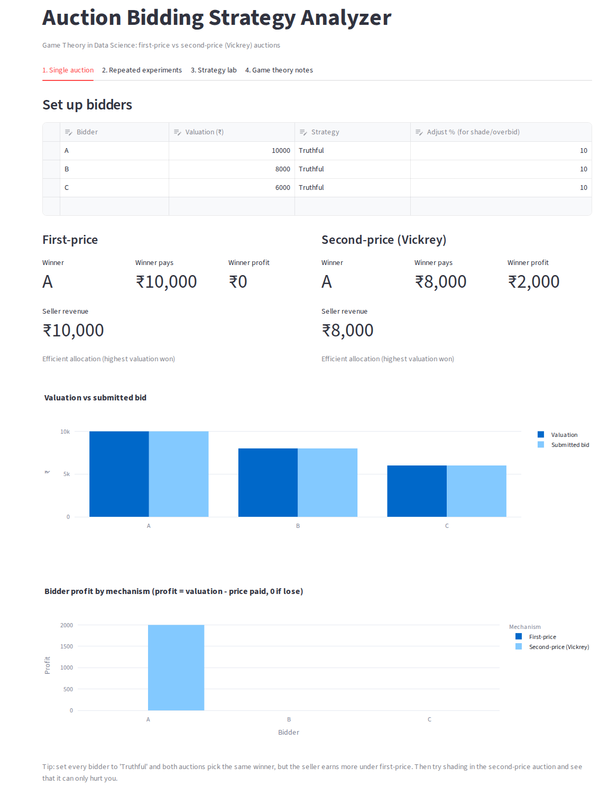
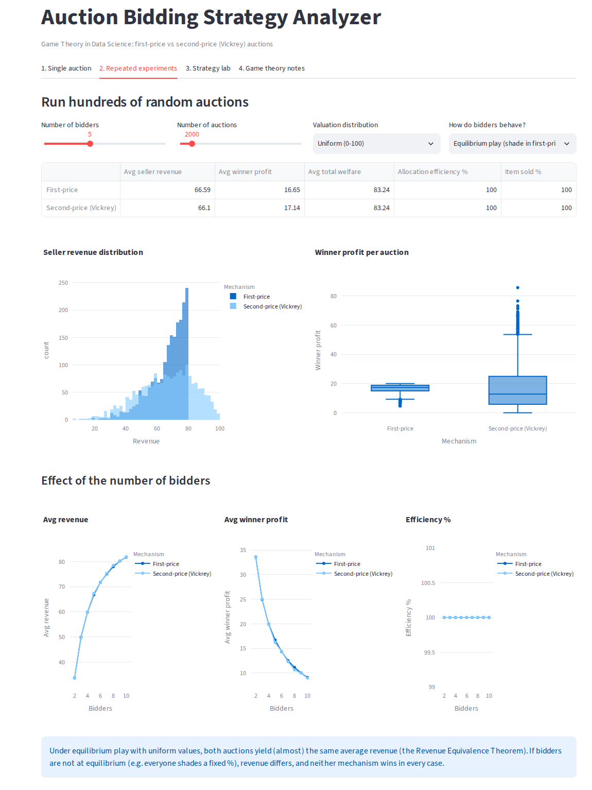
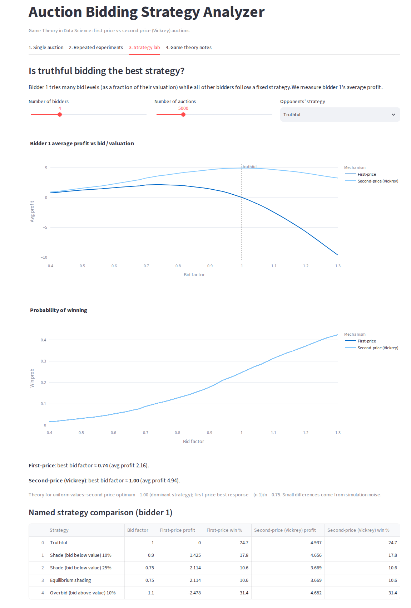
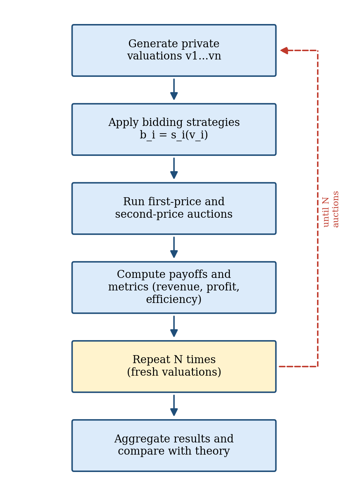

# Auction Bidding Strategy Analyzer

A game-theory mini project (Game Theory in Data Science) that simulates **first-price** and **second-price (Vickrey)** sealed-bid auctions, lets you test different bidding strategies, and compares the results with auction theory. It is built with Python, NumPy, Pandas, Plotly and Streamlit.

## Features

- **Single auction** – enter bidders, valuations and strategies, and see the winner, payment, profit and seller revenue under both auction rules side by side.
- **Repeated experiments** – run 100 to 20,000 random auctions with 2 to 10 bidders and compare average seller revenue, winner profit, welfare and allocation efficiency.
- **Strategy lab** – sweep one bidder's bid level to find the best response and see whether truthful bidding is optimal.
- **Game theory notes** – short in-app summary of payoffs, dominant strategies and revenue equivalence.
- Strategies: truthful, shading, overbidding and equilibrium shading, `b = ((n-1)/n)·v`.
- Valuation distributions: Uniform (0-100), Normal (mean 50, sd 15), Exponential (mean 30).
- Optional reserve price, random tie-breaking and a fixed random seed for reproducible runs.

## Screenshots

| Single auction | Repeated experiments |
|---|---|
|  |  |

| Strategy lab | Methodology |
|---|---|
|  |  |

## Getting started

Requires Python 3.9 or newer.

```bash
git clone https://github.com/<your-username>/<your-repo>.git
cd <your-repo>
pip install -r requirements.txt
streamlit run app.py
```

The app opens at http://localhost:8501.

## Project structure

```
.
├── app.py               # Streamlit dashboard (4 tabs)
├── auction_engine.py    # Auction rules, strategies, Monte Carlo simulation
├── requirements.txt     # streamlit, pandas, numpy, plotly
├── README.md
└── screenshots/         # Images used in this README
```

`auction_engine.py` keeps the auction rule (who wins, what is paid) separate from the bidding strategy (how a valuation becomes a bid), so new formats or strategies can be added without changing the dashboard. All simulation is vectorised with NumPy.

## How it works

1. Draw private valuations for `n` bidders (or read them from the user).
2. Convert each valuation into a bid using the chosen strategy: `bid = valuation × factor`.
3. The highest bid wins (ties broken at random). The winner pays their own bid in a first-price auction, or the highest losing bid in a second-price auction. If a reserve price is set and the highest bid is below it, the item is not sold.
4. Winner profit = valuation − payment; all other bidders earn 0. Seller revenue = payment.
5. Repeat for many auctions and compute average revenue, profit, welfare and allocation efficiency.

## Sample results

With valuations uniform on ₹0 to ₹10,000, 10,000 auctions per setting and bidders playing equilibrium strategies (seed 42):

| Bidders | Theory revenue `(n-1)/(n+1)` | Simulated first-price | Simulated second-price |
|---|---|---|---|
| 2 | ₹3,333 | ₹3,339 | ₹3,323 |
| 3 | ₹5,000 | ₹5,007 | ₹4,999 |
| 5 | ₹6,667 | ₹6,666 | ₹6,677 |
| 10 | ₹8,182 | ₹8,180 | ₹8,174 |

Main findings:

- In the **second-price** auction, truthful bidding is the best strategy (the strategy lab finds a best bid factor of 1.00).
- In the **first-price** auction, truthful bidding earns zero profit, and the best response is near `(n-1)/n` (0.74 found for 4 bidders, against 0.75 in theory).
- Under equilibrium play both formats give about the same revenue (revenue equivalence). If everyone bids truthfully, first-price earns more, but only because bidders leave profit on the table.

## Assumptions and limitations

Independent private values, risk-neutral bidders, seller value of 0, and no collusion. "Equilibrium shading" is exact only for uniform valuations without a reserve price. Risk-averse bidders, asymmetric valuations, common values and reserve prices can change the revenue ranking.

## Future work

English, Dutch and all-pay auctions; reserve prices from Myerson's optimal auction design; risk-averse and correlated bidders; reinforcement-learning bidders; GSP and VCG auctions for online advertising.

## References

1. W. Vickrey, "Counterspeculation, auctions, and competitive sealed tenders," *The Journal of Finance*, 1961.
2. R. B. Myerson, "Optimal auction design," *Mathematics of Operations Research*, 1981.
3. V. Krishna, *Auction Theory*, 2nd ed., Academic Press, 2009.
4. J. F. Nash, "Equilibrium points in n-person games," *PNAS*, 1950.

## License

Add a `LICENSE` file of your choice (for example MIT) before publishing.
